# Архитектура BullBir

Документ для разработчиков, которые приходят в проект, и для портфолио. Описывает состояние ветки
`feature/own-auth`: собственная авторизация уже единственный способ входа (этапы 1–9 плана), Firebase
Auth остался только невидимым мостом к Firestore/Storage.

Связанные документы:

| Документ | О чём |
|---|---|
| [adr/001-own-auth.md](adr/001-own-auth.md) | Почему своя авторизация и почему мост через custom token |
| [auth-api.md](auth-api.md) | Контракт `/api/auth/*`: тела запросов, ответы, коды ошибок |
| [auth-migration-plan.md](auth-migration-plan.md) | Этапы миграции, лимиты, матрица «угроза → защита → тест» |
| [migration-runbook.md](migration-runbook.md) | Импорт пользователей из Firebase Auth (этап 3) |
| [google-oauth-setup.md](google-oauth-setup.md) | Настройка Google OAuth-клиента |
| [security-review.md](security-review.md) | Разбор безопасности (готовится отдельно) |

---

## 1. Обзор

BullBir — персональное приложение для продуктивности (задачи, дневник, финансы, привычки, мандала
9×9 и т. д.) в виде PWA.

| Слой | Технология | Где в коде |
|---|---|---|
| Клиент | React 18 + Vite, Framer Motion, свой CSS на custom properties, PWA (`vite-plugin-pwa`) | `src/` |
| Хостинг | Vercel: статика + **одна** Serverless Function | `vercel.json`, `api/auth/[...route].ts` |
| Сервер авторизации | TypeScript strict, Node ≥ 22, zod | `server/` |
| Данные пользователя | Firestore (офлайн-кэш, real-time) + Storage (аватар) | `src/firebase/`, `firestore.rules`, `storage.rules` |
| Мост к данным | Firebase Auth: только `signInWithCustomToken`, claims `bb_ev`, `bb_cv` | `src/context/AuthContext.jsx`, `server/routes/auth.ts` |
| Лимиты | Upstash Redis (`@upstash/ratelimit`, sliding window) | `server/rateLimit.ts`, `server/limits.ts` |
| Почта | Resend (в разработке — вывод `[dev-mail]` в терминал) | `server/auth/mailer.ts` |
| Утёкшие пароли | Have I Been Pwned, k-anonymity | `server/auth/password.ts` |
| Вход через Google | OAuth 2.0 Authorization Code + PKCE + state + nonce, проверка ID-токена своими силами | `server/auth/oauth/` |

Главная идея: **сессия живёт в нашей httpOnly-cookie**, а Firebase Auth нужен только затем, чтобы
правила Firestore/Storage видели `request.auth`. Клиент никогда не хранит долгоживущий токен в
JavaScript: Firebase-вход держится в памяти (`inMemoryPersistence`) и после перезагрузки страницы
заново выпускается сервером по cookie.

Почему всё API — одна функция: на бесплатном тарифе Vercel не больше 12 функций в деплое, а
эндпоинтов ~25. Кроме того, единый роутер — одно место для проверки Origin, лимитов, таймаута,
ошибок и логов, которое невозможно «забыть» в новом эндпоинте (см. ADR 001).

---

## 2. Компоненты

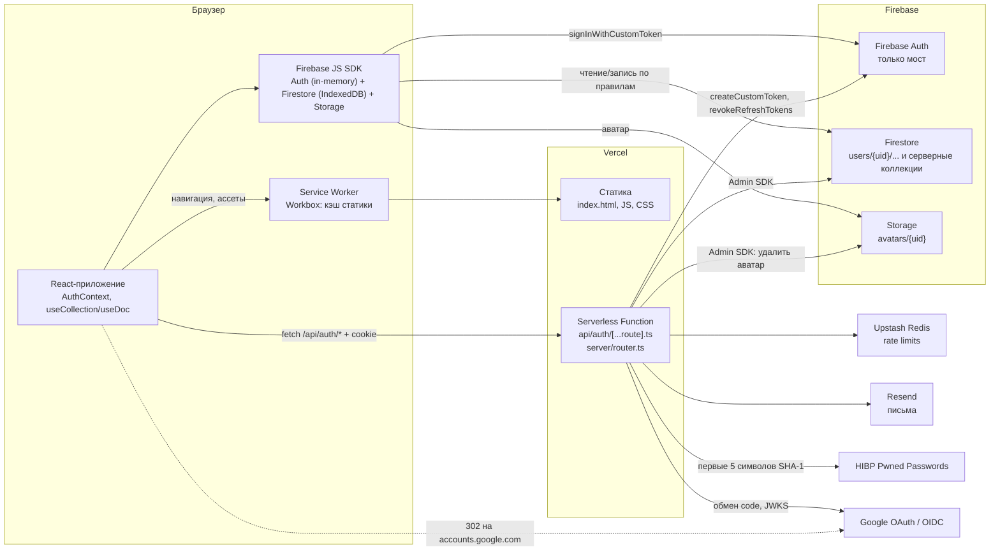

Что важно знать про каждый узел:

- **Service Worker** (`vite.config.js`): `registerType: 'autoUpdate'`, кэширует только статику
  своего origin (`style`, `script`, `worker`, `font` → `CacheFirst`) и Google Fonts. Ответы
  Firebase/Google **не кэшируются** (в них личные данные; у Firestore свой офлайн-кэш). Навигации на
  `/api/*` исключены из `navigateFallback`, чтобы OAuth-callback доходил до сервера.
- **Vercel static**: `vercel.json` переписывает всё, кроме `/api/*` и файлов с точкой, на
  `/index.html` (SPA) и добавляет заголовки безопасности (CSP и др., см. раздел 6).
- **Функция `/api/auth`**: `api/auth/[...route].ts` — три строки: `createHandler(routes)`. Вся логика
  в `server/`. Тот же роутер в разработке подключается к Vite dev server через плагин `localApi`.
- **Firestore**: данные пользователя (`users/{uid}/...`) клиент читает и пишет сам по правилам;
  серверные коллекции авторизации доступны **только** Admin SDK.
- **Firebase Auth**: записи пользователей появляются при первом `signInWithCustomToken`. Пароли там
  не используются; экранов Firebase Auth в интерфейсе нет.

---

## 3. Конвейер запроса (`server/router.ts`)

Каждый запрос к `/api/auth/*` проходит один и тот же путь. Маршруты — массив `Route`
(`server/routes/index.ts`): `{ method, path, ipLimits?, handler, noHead? }`.

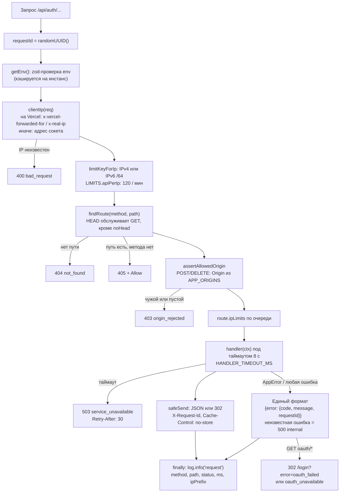

Детали, которые легко упустить:

- **Env** проверяется при первом запросе (`server/env.ts`). Ошибка называет только *имена*
  переменных, не значения. Режим определяется наличием `FIRESTORE_EMULATOR_HOST` /
  `FIREBASE_AUTH_EMULATOR_HOST`; на `VERCEL_ENV=production|preview` или `NODE_ENV=production` эмуляторные
  переменные запрещены.
- **IP**: вне Vercel заголовки `X-Forwarded-For` не учитываются (их подделывает клиент). Для лимитов
  IPv6 сворачивается в /64, для логов и сессий хранится только префикс (/24 для IPv4, /48 для IPv6).
- **Лимиты fail-closed**: если Redis недоступен или отвечает дольше 1,5 с, запрос получает
  `503 service_unavailable`, а не проходит без защиты (`enforceLimit`).
- **Origin** проверяется только для небезопасных методов (не GET/HEAD/OPTIONS). Это защита
  в дополнение к `SameSite=Lax`. GET-маршруты OAuth защищены `state` в запечатанной cookie.
- **Тело запроса** (`server/http.ts`, `server/validate.ts`): только `Content-Type: application/json`,
  максимум 16 KB, затем zod-схема; в сообщении об ошибке — только имена полей.
- **Логи** (`server/log.ts`): JSON-строки; значения под ключами вида
  `pass|secret|token|code|otp|cookie|hash|salt|key|session|…` заменяются на `[redacted]`, почта
  маскируется (`a***@mail.com`), длинные непрозрачные строки обрезаются.
- **Время ответа**: эндпоинты, работа которых зависит от того, существует ли адрес, выравниваются
  `withMinDuration` (`server/auth/pacing.ts`): ≥ 1 с для запросов кода/регистрации, ≥ 500 мс для
  `login`, ≥ 300 мс для проверки кода.

### Таблица маршрутов

| Метод и путь | Файл | Лимиты по IP (кроме общего 120/мин) |
|---|---|---|
| `GET health` | `routes/health.ts` | — |
| `POST register` | `routes/auth.ts` | `registerPerIp` 5/ч |
| `POST verify-email` | `routes/auth.ts` | `codeVerifyPerIp` 30/10 мин |
| `POST verify-email/resend` | `routes/auth.ts` | `codeRequestPerIp` 10/ч |
| `POST login` | `routes/auth.ts` | `loginPerIp` 20/10 мин |
| `POST logout`, `POST logout-all` | `routes/auth.ts` | — |
| `GET me` | `routes/auth.ts` | — |
| `POST firebase-token` | `routes/auth.ts` | — |
| `GET sessions`, `DELETE sessions/:id` | `routes/sessions.ts` | — |
| `POST otp/request`, `POST otp/verify` | `routes/otpLogin.ts` | 10/ч, 30/10 мин |
| `GET oauth/:provider/start`, `GET oauth/:provider/callback` | `routes/oauth.ts` | 20/10 мин каждый |
| `POST password/reset-request`, `POST password/reset-confirm` | `routes/account.ts` | `resetPerIp` 10/ч, 30/10 мин |
| `POST password/change` | `routes/account.ts` | — |
| `POST email/change-request`, `POST email/change-confirm` | `routes/account.ts` | 10/ч, 30/10 мин |
| `POST account/delete` | `routes/account.ts` | — |
| `GET security-events` | `routes/events.ts` | — |

Лимиты по адресу/аккаунту (`codeRequestPerEmail`, `otpSendCooldown`, `codeVerifyPerEmail` и др.)
вызываются внутри обработчиков; все значения — в `server/limits.ts`.

---

## 4. Потоки (sequence-диаграммы)

Обозначения: **B** — браузер (React + `src/auth/api.js`), **API** — функция `/api/auth`,
**FS** — Firestore через Admin SDK, **FA** — Firebase Auth (Admin), **M** — Resend.

### 4.1 Регистрация (код + тот же пароль)

`register` **ничего не создаёт**. Ожидающая регистрация (argon2id-хэш пароля и имя) хранится внутри
документа кода. Аккаунт появляется только когда владелец почты вводит код **и тот же пароль** — так
никто не может заранее «занять» чужой адрес и знать от него пароль.

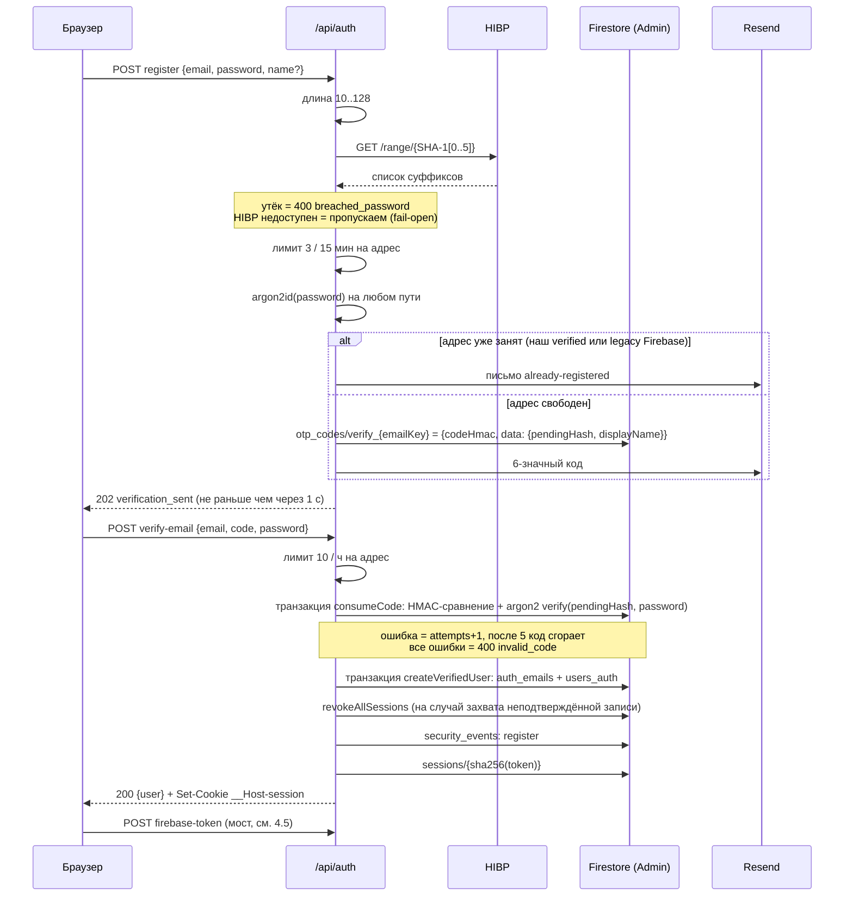

### 4.2 Вход по паролю (блокировка и ленивая миграция scrypt)

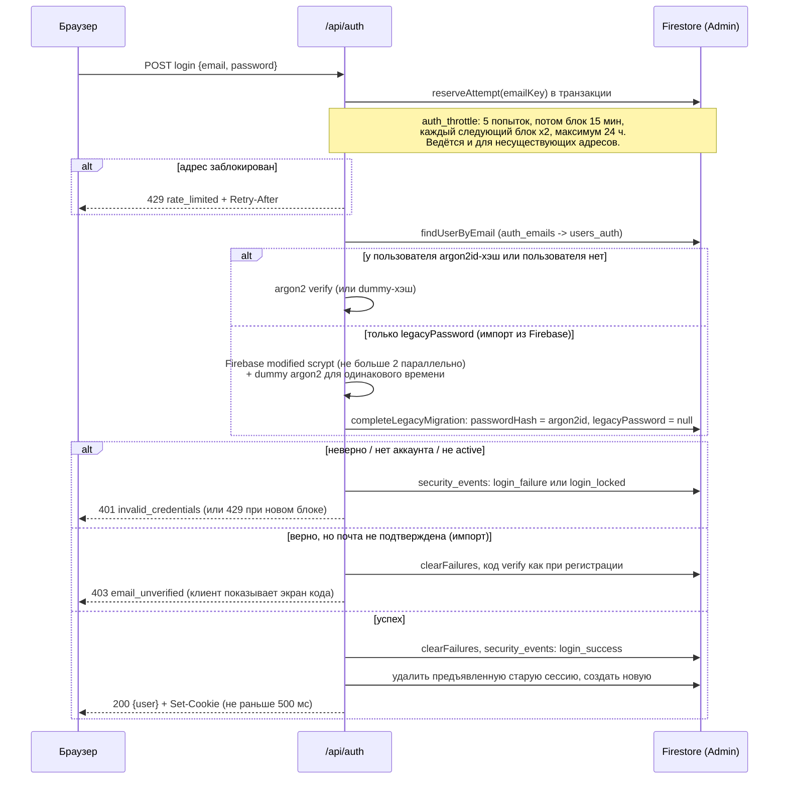

### 4.3 Вход по коду на почту (код привязан к браузеру)

Код — 8 цифр. Запрос ставит httpOnly-cookie `__Host-otp` (`SameSite=Strict`) со случайным значением;
документ кода хранится под `login_{emailKey}_{sha256(challenge)}`. Чужой браузер не может ни
заменить, ни подобрать, ни «сжечь» код владельца.

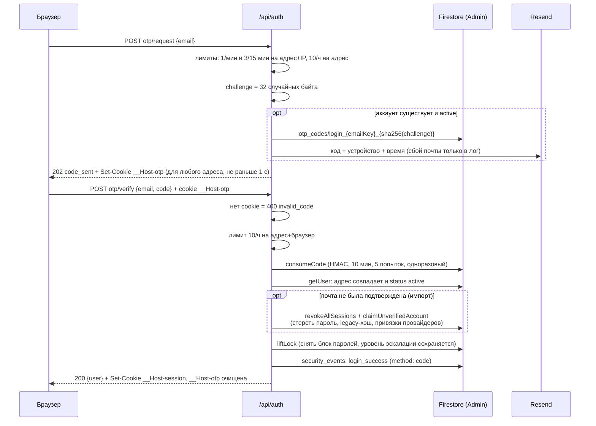

### 4.4 Вход через Google (PKCE, state, nonce, правила привязки)

Обе ручки — навигации верхнего уровня (`window.location.assign('/api/auth/oauth/google/start')`),
поэтому любые ошибки превращаются в `302 /login?error=oauth_*`, а не в JSON. Секреты потока
(state, nonce, PKCE verifier) не пишутся в базу: они лежат в cookie `__Host-oauth`, запечатанной
AES-256-GCM ключом, выведенным из `AUTH_PEPPER` через HKDF; срок 10 минут.

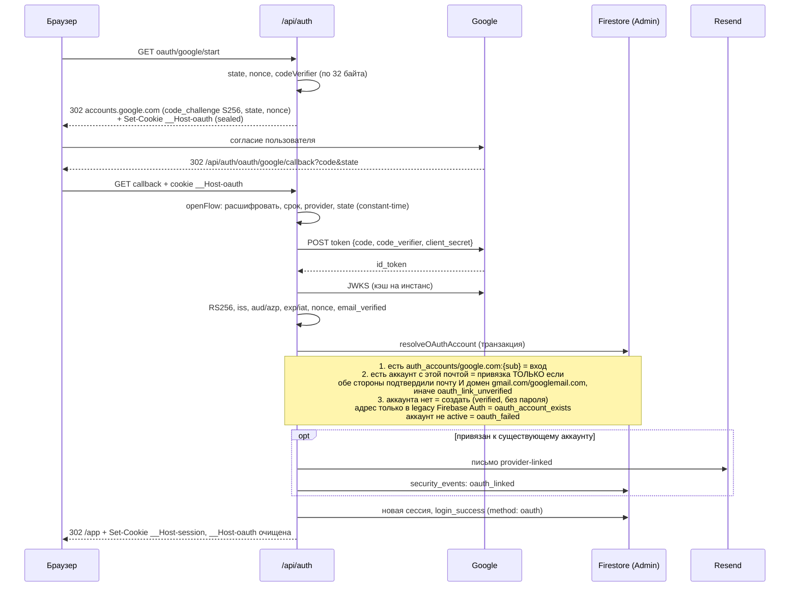

Почему только gmail.com: для других доменов Google-аккаунт может создать тот, кто владеет доменом
*сейчас* (например, корпоративный домен сменил владельца). Владелец такого аккаунта входит другим
способом.

### 4.5 Мост к Firebase

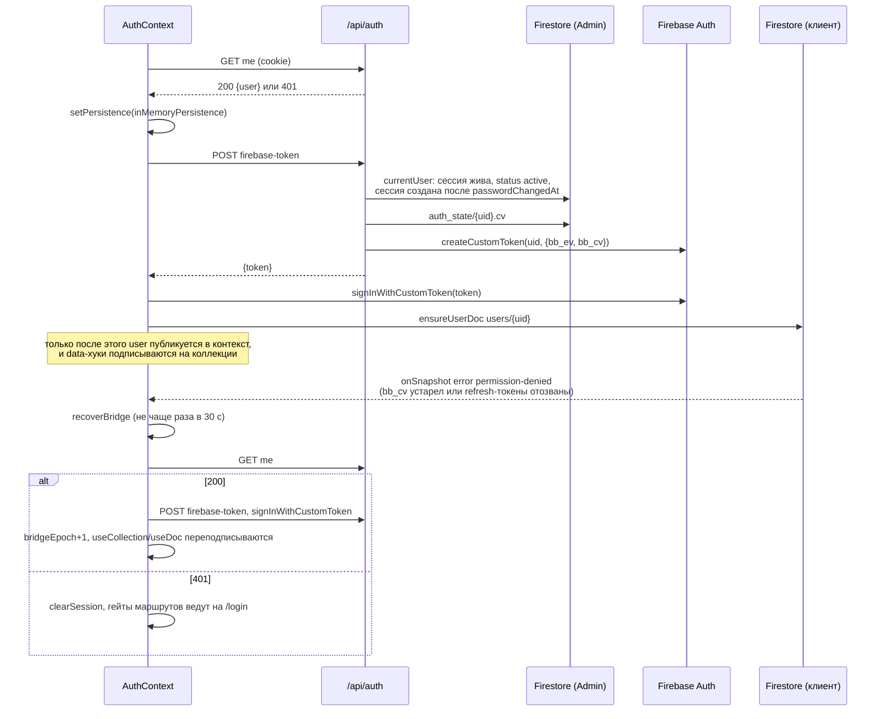

Ключевые свойства моста:

- **`bb_ev`** — подтверждена ли почта. Правила проверяют его вместо Firebase-поля `email_verified`.
- **`bb_cv`** — версия учётных данных на момент выпуска токена. Правила требуют
  `bb_cv >= auth_state/{uid}.cv`. Сервер поднимает `cv` (текущее время в мс) при смене/сбросе пароля,
  смене почты, «выйти везде», захвате неподтверждённой записи. Все ранее выпущенные ID-токены и даже
  ещё не обменянные custom-токены **сразу** теряют доступ. Сам по себе `revokeRefreshTokens`
  оставил бы ID-токены живыми до часа.
- **In-memory persistence** (`src/firebase/config.js`, `initializeAuth(app, { persistence:
  inMemoryPersistence })`): Firebase-сессия не переживает вкладку, а значит не переживает нашу cookie.
  Если `me` отвечает 401, а в браузере остался старый Firebase-вход, он принудительно завершается.
- Если пользователь сам сменил пароль или почту, клиент вызывает `rebridge(user)` сразу, не дожидаясь
  `permission-denied`.

### 4.6 Сброс пароля

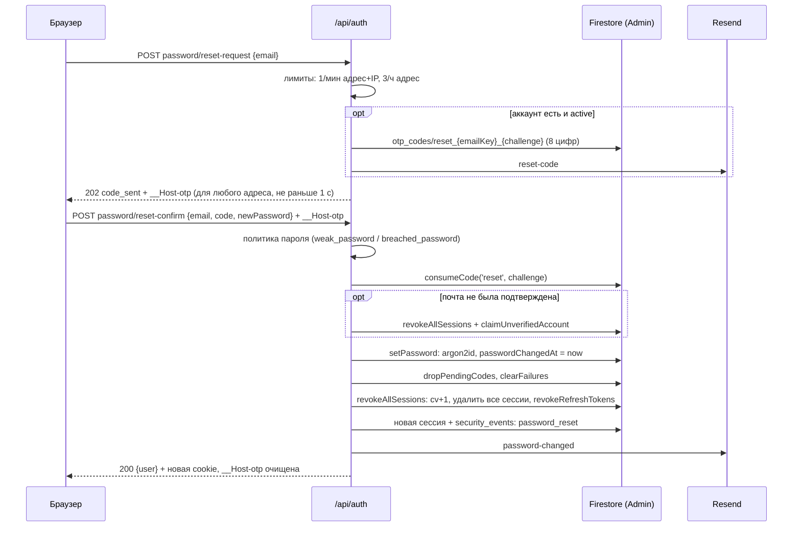

`password/change` устроен так же, но требует сессию и `currentPassword` (неверный пароль считается
попыткой в той же блокировке `auth_throttle`). Аккаунт без пароля получает `password_not_set` и
должен задать пароль через сброс.

### 4.7 Смена почты

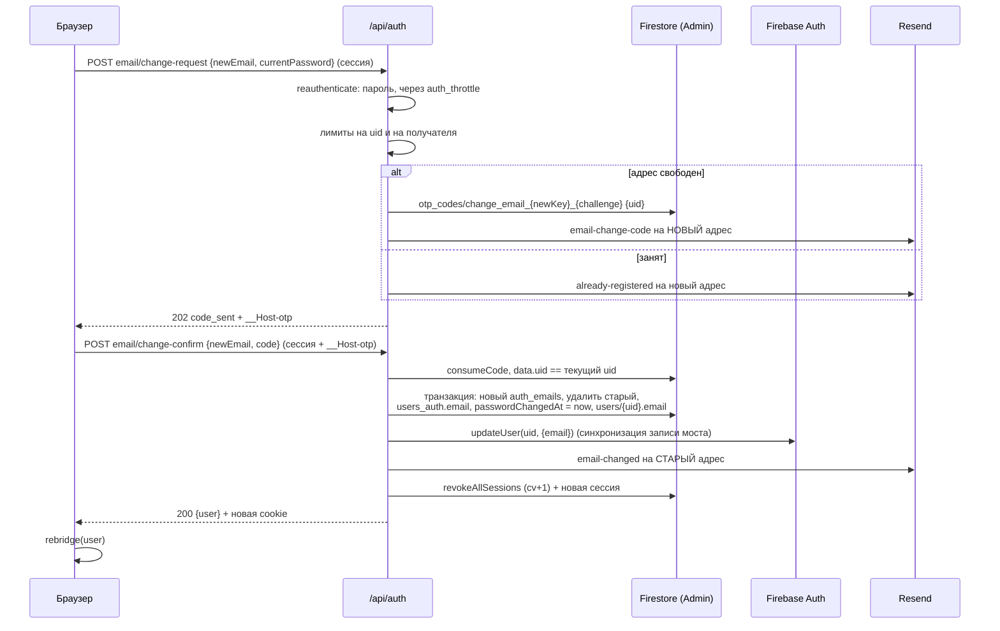

### 4.8 Удаление аккаунта

Клиент (`deleteAccountAndData` в `src/firebase/account.js`) вызывает сервер, затем стирает локальный
офлайн-кэш Firestore и делает жёсткий переход на `/`. Каждый шаг на сервере идемпотентен: повторный
запрос доделывает прерванное удаление.

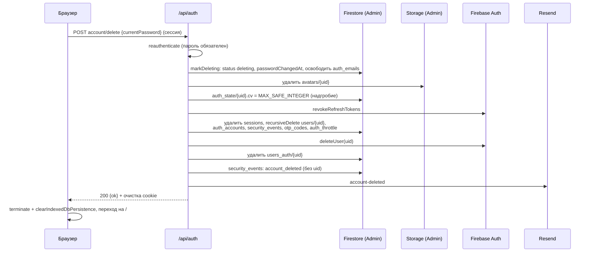

### 4.9 Выход и «выйти везде»

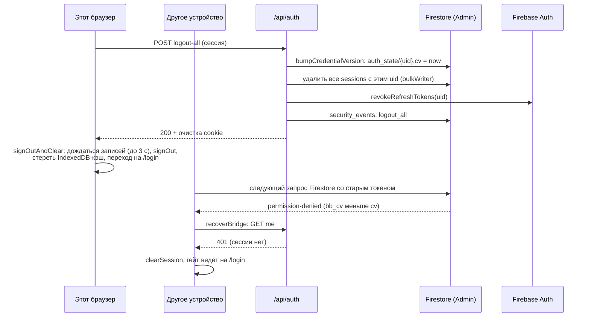

Обычный `logout` удаляет только текущую сессию и вызывает `revokeRefreshTokens` (без повышения
`cv`): другие устройства с живыми сессиями тихо перевыпускают мост. `DELETE sessions/:id` («Мои
устройства») работает так же для одной выбранной сессии.

---

## 5. Модель данных

### 5.1 Серверные коллекции (только Admin SDK)

Клиенту в `firestore.rules` для каждой из них явно прописано `allow read, write: if false` (плюс
общий запрет по умолчанию). Ключ `emailKey` = `sha256("email:" + нормализованная почта)`;
нормализация — `NFKC`, `trim`, `toLowerCase` (`server/auth/email.ts`).

| Коллекция / id документа | Поля | Срок жизни (TTL-поле) | Код |
|---|---|---|---|
| `users_auth/{uid}` | `email`, `emailVerified`, `passwordHash` (argon2id или `null`), `legacyPassword` (`{hash, salt}` scrypt или `null`), `displayName`, `providers` (`password`, `google.com`), `status` (`active` / `deleting`), `passwordChangedAt`, `createdAt`, `updatedAt`, `lastLoginAt`, `migratedAt?` | бессрочно | `auth/users.ts` |
| `auth_emails/{emailKey}` | `uid`, `createdAt` — делает адрес уникальным, создаётся в той же транзакции | бессрочно | `auth/users.ts` |
| `auth_accounts/{providerId}:{sub}` (сейчас `google.com:{sub}`) | `uid`, `provider`, `email`, `linkedAt` | бессрочно | `auth/oauth/accounts.ts` |
| `sessions/{sha256(token)}` | `uid`, `publicId` (32 hex, показывается в «Мои устройства»), `createdAt`, `lastSeenAt`, `idleExpiresAt` (+7 дней, продлевается не чаще раза в 15 мин), `absoluteExpiresAt` (+30 дней), `device` («Chrome · Windows»), `ipPrefix` | `expiresAt` = min(idle, absolute) | `auth/sessions.ts` |
| `otp_codes/{purpose}_{emailKey}[_{sha256(challenge)}]` | `purpose` (`verify` / `login` / `reset` / `change_email`), `codeHmac`, `attempts`, `createdAt`, `data` (`{pendingHash, displayName}` или `{uid}`) | `expiresAt` = +10 мин | `auth/otp.ts` |
| `auth_throttle/{emailKey}` | `failures`, `level`, `lockedUntil`, `updatedAt` | `expiresAt` = +2 дня | `auth/throttle.ts` |
| `auth_state/{uid}` | `cv` (версия учётных данных, мс; после удаления — `MAX_SAFE_INTEGER`), `updatedAt` | бессрочно (надгробие нужно, чтобы старые токены не ожили) | `auth/credentials.ts` |
| `security_events/{auto}` | `uid?`, `type` (15 типов), `ipPrefix`, `device`, `at`, `meta` (только разрешённые поля: `method`, `provider`, `reason`, `count`, `retryAfterSec`, `wasCurrent`) | `expiresAt` = +180 дней | `auth/events.ts` |

Типы событий: `register`, `email_verified`, `login_success`, `login_failure`, `login_locked`,
`logout`, `logout_all`, `session_revoked`, `password_changed`, `password_reset`, `email_changed`,
`oauth_linked`, `account_deleted`, `breached_password_rejected`, `hibp_unavailable`. Запись события
никогда не ломает вход: ошибки только логируются.

> **TTL-политики** Firestore на поле `expiresAt` для `sessions`, `otp_codes`, `auth_throttle`,
> `security_events` включаются в консоли Firebase (Firestore → TTL). Код не полагается на них для
> безопасности: просроченные сессии и коды отвергаются при проверке, TTL лишь убирает мусор.

Индексы (`firestore.indexes.json`): составной `security_events (uid ASC, at DESC)` для
`GET security-events`. Остальные запросы (`sessions where uid`, `otp_codes where data.uid`,
`auth_accounts where uid`) — по одному полю.

### 5.2 Данные пользователя

```
users/{uid}                       профиль: email, displayName, photoURL, onboardingDone, language,
                                  theme, bio, birthDate, firstName, lastName, phone, createdAt
users/{uid}/{collection}/{docId}  tasks, journalEntries, events, transactions, moods, notes, goals,
                                  habits, pomodoro, reminders, shifts, savingsGoals, mandalas, aiState
avatars/{uid}                     (Storage) аватар
aiDomains/{id}, aiIntents/{id}    общая библиотека ассистента (правят админы)
admins/{uid}                      список админов (только из консоли)
```

Модули работают с данными через `useCollection` / `useDoc` (`src/hooks/`), которые ставят
`createdAt`/`updatedAt` через `serverTimestamp()`, ничего не делают без входа и переподписываются при
смене `bridgeEpoch`.

### 5.3 Что разрешают правила

| Путь | Чтение | Запись |
|---|---|---|
| `users/{uid}` | владелец + `freshCredentials` | create: владелец, ≤ 60 полей, белый список полей. update: только «пользовательские» поля (`email` и `createdAt` менять нельзя). Подтверждённая почта **не** нужна — профиль создаётся сразу после входа |
| `users/{uid}/{col}/{doc}` | владелец + `bb_ev == true` + `col` из белого списка + `freshCredentials` | то же + ≤ 60 полей |
| `aiDomains`, `aiIntents` | любой вошедший с `bb_ev` | только админ (`admins/{uid}` существует) |
| `admins/{uid}` | только свой документ | запрещено |
| серверные коллекции (5.1) | запрещено | запрещено |
| всё остальное | запрещено | запрещено |
| Storage `avatars/{uid}` | владелец + `freshCredentials` | владелец + `freshCredentials` + `bb_ev`, < 2 МБ, PNG, JPEG, WebP или GIF (без SVG) |

`freshCredentials(uid)` = документа `auth_state/{uid}` нет **или** `bb_cv >= cv`. В Storage
используется межсервисное чтение `firestore.get(...)`. Новая коллекция данных должна попасть и в
`isKnownCollection` (`firestore.rules`), и в `USER_COLLECTIONS` (`src/firebase/account.js`).

---

## 6. Модель безопасности (кратко)

Полный разбор — в [security-review.md](security-review.md). Здесь — карта решений.

**Сессии**
- Токен — 32 случайных байта (base64url) в cookie `__Host-session`: `HttpOnly; Secure;
  SameSite=Lax; Path=/`, `Max-Age` 30 дней. Префикс `__Host-` запрещает поддоменам её
  перезаписать.
- В базе только SHA-256 токена; утечка базы не даёт войти. Неактивность 7 дней, максимум 30 дней.
- Новый токен на каждый вход; при смене пароля/почты все сессии заканчиваются (`passwordChangedAt`
  + удаление + `cv`). `currentUser` дополнительно отвергает сессии, созданные до
  `passwordChangedAt`, и сессии неактивных аккаунтов.

**Секреты в покое**

| Что | Как хранится |
|---|---|
| Пароль | argon2id (`@node-rs/argon2`, m = 19 MiB, t = 2, p = 1). Для несуществующих аккаунтов — проверка против dummy-хэша (одинаковое время) |
| Старый пароль Firebase | modified scrypt до первого входа, затем argon2id и удаление |
| Токен сессии, challenge кода | SHA-256 |
| Одноразовый код | HMAC-SHA-256 с `AUTH_PEPPER` над `docId:code`; сравнение `timingSafeEqual` |
| OAuth-поток | AES-256-GCM в cookie, ключ HKDF(`AUTH_PEPPER`) |
| Почта в ключах и лимитах | `sha256("email:" + адрес)` |
| IP | только префикс /24 или /48 |

**Против перебора и перечисления аккаунтов**: лимиты по IP и по адресу (Upstash, fail-closed),
блокировка паролей с удвоением, одинаковые ответы и выравнивание времени на всех «узнай, есть ли
адрес» эндпоинтах; сбой почты не меняет ответ.

**CSRF**: `SameSite=Lax` + проверка `Origin` на всех POST/DELETE; `__Host-otp` — `SameSite=Strict`;
OAuth защищён `state` в запечатанной cookie.

**CSP и заголовки** (`vercel.json`): `default-src 'self'`, `script-src 'self'` (без inline и eval),
`connect-src` — свой origin, `*.googleapis.com`, `*.firebasestorage.app`, Google Fonts;
`frame-src 'none'`, `frame-ancestors 'none'`, `object-src 'none'`, `form-action 'self'`,
`upgrade-insecure-requests`; HSTS 2 года с preload, `X-Frame-Options: DENY`, `nosniff`,
`Referrer-Policy`, `Permissions-Policy`, COOP. Поскольку Firebase Auth используется без
popup/redirect, `apis.google.com` и скрытый iframe не нужны. Новый внешний хост надо добавить в CSP.

**Правила Firestore/Storage**: изоляция по uid, белые списки коллекций и полей, `bb_ev` для данных,
`bb_cv` против старых токенов, явный запрет серверных коллекций. Покрыты тестами на эмуляторе.

**Выход на клиенте**: `signOutAndClear` ждёт отложенные записи, выходит из моста, стирает
IndexedDB-кэш Firestore и старый SW-кэш `firebase-api`.

---

## 7. Конфигурация

### 7.1 Переменные сервера (`server/env.ts`)

Схема выбирается автоматически: есть `FIRESTORE_EMULATOR_HOST` или `FIREBASE_AUTH_EMULATOR_HOST` —
режим **emulator**, иначе — **production** (это касается и preview-деплоев Vercel). Эмуляторные
переменные на деплое запрещены.

| Переменная | Смысл | Эмулятор | Production |
|---|---|---|---|
| `NODE_ENV` | `development` / `test` / `production` | по умолчанию `development` | ставит Vercel |
| `VERCEL_ENV` | `development` / `preview` / `production` (ставит Vercel) | — | авто |
| `FIREBASE_PROJECT_ID` | id проекта Firebase | обязательно (`demo-bullbir`) | обязательно |
| `APP_ORIGINS` | список origin через запятую для проверки Origin и OAuth redirect | обязательно (`http://localhost:5173`) | обязательно, только `https`, не localhost |
| `AUTH_PEPPER` | base64 ≥ 32 случайных байт: HMAC кодов, ключ OAuth-cookie | обязательно | обязательно |
| `FIRESTORE_EMULATOR_HOST` | адрес эмулятора Firestore (`127.0.0.1:8080`) | обязательно | **запрещено** |
| `FIREBASE_AUTH_EMULATOR_HOST` | адрес эмулятора Auth (`127.0.0.1:9099`) | обязательно | **запрещено** |
| `FIREBASE_STORAGE_EMULATOR_HOST` | адрес эмулятора Storage (`127.0.0.1:9199`), читает Admin SDK; zod-схема его не проверяет | для удаления аватара локально | не задавать |
| `FIREBASE_SERVICE_ACCOUNT_BASE64` | JSON сервисного аккаунта в base64 | не нужно | обязательно |
| `UPSTASH_REDIS_REST_URL`, `UPSTASH_REDIS_REST_TOKEN` | Redis для лимитов | не нужно (лимитер в памяти) | обязательно |
| `RESEND_API_KEY`, `MAIL_FROM` | ключ Resend и отправитель на подтверждённом домене | не нужно (письма в терминал) | обязательно |
| `FIREBASE_HASH_SIGNER_KEY`, `FIREBASE_HASH_SALT_SEPARATOR`, `FIREBASE_HASH_ROUNDS`, `FIREBASE_HASH_MEM_COST` | параметры scrypt Firebase для ленивой миграции паролей (консоль → Authentication → Password hash parameters) | необязательно | обязательно |
| `FIREBASE_STORAGE_BUCKET` | бакет для удаления аватара сервером | необязательно (по умолчанию `<project>.appspot.com`) | рекомендуется (без него аватар не удаляется, пишется warning) |
| `GOOGLE_CLIENT_ID`, `GOOGLE_CLIENT_SECRET` | OAuth-клиент Google | необязательно | необязательно; без них `oauth_unavailable` |
| `OAUTH_REDIRECT_BASE` | origin, на который Google вернёт пользователя; должен входить в `APP_ORIGINS` | по умолчанию первый из `APP_ORIGINS` | то же |
| `VERCEL` | ставит Vercel; включает доверие к `x-vercel-forwarded-for` | — | авто |

Шаблон — `.env.example` (все серверные ключи с пустыми секретами). Плагин `localApi` в
`vite.config.js` переносит из `.env.local` в `process.env` только перечисленные серверные ключи
(`SERVER_ENV_KEYS`); у них нет префикса `VITE_`, поэтому они никогда не попадают в бандл браузера.

### 7.2 Переменные клиента

| Переменная | Смысл |
|---|---|
| `VITE_FIREBASE_API_KEY`, `VITE_FIREBASE_AUTH_DOMAIN`, `VITE_FIREBASE_PROJECT_ID`, `VITE_FIREBASE_STORAGE_BUCKET`, `VITE_FIREBASE_MESSAGING_SENDER_ID`, `VITE_FIREBASE_APP_ID` | публичная конфигурация Firebase Web SDK (шаблон `.env.local.example`). Если чего-то нет, `firebaseReady = false`: приложение запускается на demo-конфиге и не ходит в сеть |
| `VITE_USE_EMULATORS` | `true` — клиент подключается к эмуляторам Auth/Firestore/Storage. Работает **только** в dev-сервере (`import.meta.env.DEV`); продакшн-сборка к эмуляторам подключиться не может |

### 7.3 Локальная разработка

```bash
cp .env.example .env.local      # заполнить AUTH_PEPPER: openssl rand -base64 32
npm install
npm run emulators               # терминал 1: auth 9099, firestore 8080, storage 9199, проект demo-bullbir
npm run dev                     # терминал 2: http://localhost:5173
```

- `/api/auth/*` в dev обслуживает тот же `server/router.ts` через `server.ssrLoadModule`
  (правки TypeScript применяются без перезапуска).
- Без эмуляторных переменных или без запущенных эмуляторов локальный API сразу отвечает
  `503 service_unavailable` с подсказкой, вместо того чтобы висеть до 8-секундного таймаута.
  Локальная разработка никогда не ходит в настоящий Firebase-проект.
- Письма (коды) печатаются в терминале dev-сервера блоком `[dev-mail]`; в структурный лог коды не
  попадают.
- Лимиты в режиме эмулятора работают по-настоящему, но в памяти процесса (`MemoryRateLimiter`).
- Cookie с префиксом `__Host-` и флагом `Secure` Chrome и Firefox принимают на `http://localhost`
  (localhost считается безопасным контекстом). В других браузерах локальный вход может не работать.

### 7.4 Деплой

- Vercel: переменные production из таблицы 7.1, клиентские `VITE_FIREBASE_*`.
- Правила и индексы: `firebase deploy --only firestore:rules,firestore:indexes,storage`.
- TTL-политики на `expiresAt` — в консоли Firestore.
- Импорт старых пользователей — `npm run migrate:users -- <export.json>` (по умолчанию dry run,
  см. [migration-runbook.md](migration-runbook.md)).

---

## 8. Тестирование

Фронтенд-тестов и e2e нет: UI проверяется вручную (dev-сервер + браузер). Сервер и правила покрыты
двумя наборами Vitest.

| Набор | Команда | Что нужно | Где |
|---|---|---|---|
| Unit | `npm test` | ничего | `tests/unit/` |
| Эмулятор | `npm run test:emulator` | Firebase CLI + Java 21; поднимает auth/firestore/storage на проекте `demo-bullbir` через `firebase emulators:exec` | `tests/emulator/`, конфиг `vitest.emulator.config.js` (файлы по очереди, общая база) |
| Типы | `npm run typecheck` | — | `tsc -p tsconfig.server.json`: `api/`, `server/`, `tests/`, `scripts/` в strict |
| Линт | `npm run lint` | — | ESLint по всему репозиторию |

**Unit** (`tests/unit/`) — чистые функции и роутер с подменёнными зависимостями:

| Файл | Что проверяет |
|---|---|
| `router.test.ts` | порядок конвейера, 404/405, Origin, лимиты, таймаут, формат ошибок, OAuth-редиректы |
| `env.test.ts` | схемы emulator/production, запрет эмулятора на деплое, ошибки без значений |
| `http.test.ts`, `origin.test.ts` | IP и префиксы, чтение JSON (лимит 16 KB), проверка Origin |
| `rateLimit.test.ts` | sliding window в памяти, fail-closed при сбое лимитера |
| `log.test.ts`, `events.test.ts` | редактирование секретов, белый список `meta`, журнал не ломает поток |
| `auth-units.test.ts` | crypto, нормализация почты, cookie, `deviceLabel`, длительность блокировки, политика паролей |
| `legacy-hash.test.ts` | Firebase scrypt, параметры, хелперы `migrate-users` (в т. ч. защита от захвата через импорт Google-привязки) |
| `oauth-flow.test.ts`, `oauth-google.test.ts`, `oauth-linking.test.ts`, `oauth-routes.test.ts` | PKCE, запечатанная cookie, проверка ID-токена, правила привязки, маршруты start/callback |
| `otp-login.test.ts` | `otp/request` и `otp/verify` |

**Эмулятор** (`tests/emulator/`, хелпер `helpers/authHarness.ts`) — настоящие Firestore/Auth/Storage:

| Файл | Что проверяет |
|---|---|
| `firestore.rules.test.ts`, `storage.rules.test.ts` | правила (`@firebase/rules-unit-testing`): изоляция, белые списки, `bb_ev`, `bb_cv` против `cv`, запрет серверных коллекций |
| `auth-flow.test.ts` | регистрация → код → сессия → мост, отсутствие перечисления, коды, политика паролей, вход и блокировка, сессии, выход |
| `bridge.test.ts` | custom token, claims, отзыв |
| `otp-login.test.ts` | вход по коду, привязка к браузеру, захват неподтверждённой записи |
| `oauth-google.test.ts`, `events-oauth.test.ts` | Google-вход с поддельным провайдером, state/cookie, отключённые аккаунты, события |
| `account-stage7.test.ts` | сброс и смена пароля, смена почты, удаление аккаунта |
| `migration-login.test.ts`, `migration-script.test.ts` | ленивая миграция scrypt, неподтверждённые импортированные аккаунты, скрипт импорта |
| `events-journal.test.ts` | события каждого потока, `GET security-events`, сбойный журнал не ломает вход |

Тестовые швы в коде (не трогать в продакшн-путях): `setRateLimiterForTests`, `setMailerForTests`,
`setEventSinkForTests`, `setBreachCheckerForTests`, `setClockForTests`, `setMinResponseMsForTests`,
`resetEnvForTests`, зависимости `createOAuthRoutes(deps)`.

---

## 9. Карта каталогов

```
api/
  auth/[...route].ts        единственная Vercel Function: createHandler(routes)

server/                     TypeScript strict, Node >= 22
  router.ts                 конвейер запроса, таймаут 8 с, формат ошибок
  env.ts                    zod-схема окружения, режимы emulator / production
  http.ts                   readJson (16 KB), clientIp, ipPrefix, limitKeyForIp, sendJson
  origin.ts                 проверка Origin для небезопасных методов
  rateLimit.ts              Upstash и in-memory лимитеры, enforceLimit (fail-closed)
  limits.ts                 все правила лимитов
  errors.ts                 AppError и таблица code -> HTTP-статус
  validate.ts               parseBody: JSON + zod, ошибки без значений
  log.ts                    структурный лог с редактированием секретов
  firebaseAdmin.ts          Admin SDK: adminDb, adminAuth, adminBucket
  routes/
    index.ts                список всех маршрутов
    health.ts               GET health
    auth.ts                 register, verify-email(+resend), login, logout(-all), me, firebase-token;
                            общие startSession, currentUser, assertNewPassword
    sessions.ts             GET sessions, DELETE sessions/:id
    otpLogin.ts             otp/request, otp/verify
    oauth.ts                oauth/:provider/start, oauth/:provider/callback
    account.ts              password reset/change, email change, account/delete
    events.ts               GET security-events
  auth/
    users.ts                users_auth, auth_emails; создание, захват неподтверждённых, миграция
    sessions.ts             sessions: создать, найти, продлить, отозвать; revokeFirebaseTokens
    credentials.ts          auth_state: credential version (bb_cv), надгробие
    otp.ts                  otp_codes: выпуск и атомарное потребление кодов
    challenge.ts            привязка кода к браузеру (__Host-otp), 8 цифр
    throttle.ts             auth_throttle: блокировка паролей с удвоением
    password.ts             argon2id, dummy-проверка, политика длины, HIBP
    passwordCheck.ts        проверка пароля при входе + ленивая миграция scrypt
    legacyHash.ts           Firebase modified scrypt
    accountOps.ts           setPassword, changeAccountEmail, deleteAccount, dropPendingCodes
    events.ts               security_events: белый список meta, запись, чтение
    mailer.ts               шаблоны писем, Resend / [dev-mail]
    cookies.ts              __Host-session, __Host-otp
    crypto.ts               случайные токены, uid, коды, SHA-256, HMAC, constant-time
    email.ts                нормализация почты, emailKey, zod-схема
    device.ts               «Chrome · Windows» из User-Agent
    pacing.ts               withMinDuration: выравнивание времени ответа
    time.ts                 часы (подменяемые в тестах), Timestamp <-> мс
    oauth/
      provider.ts           интерфейс OAuthProvider, OAuthError
      config.ts             реестр провайдеров, redirect base, callbackUrl
      flow.ts               state/nonce/PKCE, AES-GCM cookie __Host-oauth
      google.ts             Google: authorize URL, обмен code, проверка ID-токена
      jwt.ts                RS256-проверка JWT, кэш JWKS
      accounts.ts           auth_accounts, правила привязки (decideLink)

scripts/
  migrate-users.ts          импорт экспорта Firebase Auth (dry run по умолчанию)

src/ (части, связанные с авторизацией)
  main.jsx                  LangProvider > ThemeProvider > ToastProvider > AuthProvider > Router > App
  App.jsx                   гейты: вход -> подтверждённая почта -> онбординг -> /app/*
  auth/api.js               fetch-клиент /api/auth (credentials: same-origin), коды ошибок -> auth/*
  context/AuthContext.jsx   useAuth(): сессия по cookie, мост, recoverBridge, bridgeEpoch, все действия
  firebase/config.js        init Firebase: inMemoryPersistence, офлайн-кэш Firestore, эмуляторы
  firebase/account.js       USER_COLLECTIONS, signOutAndClear, deleteAccountAndData, проверка аватара
  hooks/useCollection.js,   подписки на данные; на permission-denied вызывают recoverBridge
  hooks/useDoc.js

firestore.rules, storage.rules, firestore.indexes.json, firebase.json   правила, индексы, эмуляторы
vercel.json                 SPA-rewrite, CSP и заголовки безопасности
vite.config.js              PWA/Workbox, плагин localApi для /api/auth в dev
tests/unit, tests/emulator  см. раздел 8
```

---

## Приложение: известные расхождения документации и кода

На момент написания (проверено по коду):

- `docs/auth-api.md` описывает для `email/change-request` и `account/delete` вариант без пароля
  (сессия младше 10 минут, иначе `reauth_required`). В коде (`server/routes/account.ts`,
  `reauthenticate`) пароль обязателен всегда; аккаунт без пароля получает `password_not_set` и
  задаёт пароль через сброс. Код ошибки `reauth_required` объявлен в `server/errors.ts`, но не
  используется.
- `docs/auth-api.md` не перечисляет `GET health` и `GET security-events`.
- В `docs/auth-migration-plan.md` удаление аккаунта записано как `DELETE /account`; фактический
  маршрут — `POST account/delete`. Там же в модели `users_auth` указаны `status: 'locked'` и
  `lockedUntil`; на деле блокировка хранится в `auth_throttle`, а `status` бывает `active` или
  `deleting`.
